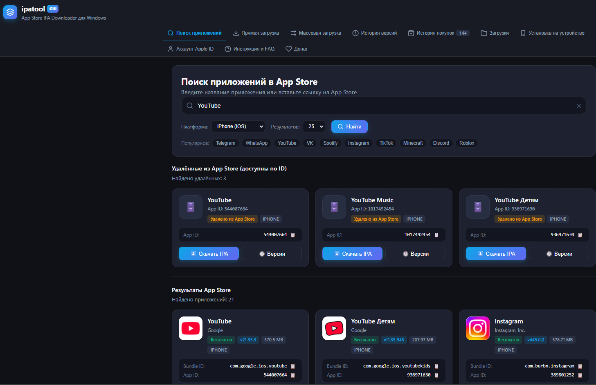

# 🖥️ Инструкция по использованию ipatool GUI для Windows

Графический интерфейс (GUI) для программы **ipatool** разработан специально для того, чтобы **любой пользователь без технических навыков** мог легко искать, получать лицензии и скачивать официальные установочные пакеты **`.ipa`** из Apple App Store на компьютере под управлением Windows.

---

## 🚀 Быстрый запуск в 1 клик

1. **Скачайте архив с программой** и распакуйте его в удобную папку (например, на Рабочий стол или в папку «Загрузки»).
2. **Запустите программу двойным кликом мыши:**
   - Дважды нажмите на **`ipatool-gui.bat`** (или **`ipatool.exe`**).
3. В браузере (или в отдельном окне приложения) автоматически откроется красивый и понятный интерфейс:

---

## 📖 Основные разделы и возможности

### 1. 👤 Вход в аккаунт Apple ID (Вкладка «Аккаунт Apple ID»)
Серверы Apple App Store отдают установочные пакеты приложений только авторизованным пользователям, подписывая пакет персональной лицензией:
- Введите свой **Apple ID (Email)** и **Пароль**.
- Нажмите **«Войти в Apple ID»**.
- Если на аккаунте включена двухфакторная защита (2FA), появится окно с просьбой ввести **6-значный проверочный код**, который придет на ваш iPhone, iPad, Mac или в SMS.
- После успешного входа статус изменится на зеленый индикатор **«Авторизован»** с отображением вашего имени и региона.

> 🔒 **Безопасность:** Ваши данные передаются напрямую на официальные серверы Apple по зашифрованному протоколу (SRP-6a/GSA). Пароли не сохраняются в открытом виде и не передаются третьим лицам.

---

### 2. 🔍 Поиск приложений (Вкладка «Поиск приложений»)
- В строке поиска введите название любого приложения (например: `Telegram`, `VK`, `WhatsApp`, `Minecraft`, `Spotify`) или просто вставьте ссылку на страницу приложения в App Store (`https://apps.apple.com/...`).
- Выберите платформу: **iPhone (iOS)**, **iPad (iPadOS)** или **Apple TV (tvOS)**.
- Нажмите **«Найти»**.
- В результатах поиска появятся карточки приложений с официальными иконками, версиями, ценами и идентификаторами (Bundle ID / App ID).
- Сначала показывается блок **«Удалённые из App Store (доступны по ID)»** — приложения, которых уже нет в поиске Apple, но которые всё ещё можно скачать по числовому App ID (каталог `Apps_ID_List.txt` рядом с программой).
  Искать в нём можно и по названию, и по App ID: точное совпадение ID или начала названия поднимается наверх списка.
  Ниже отдельным блоком идут обычные результаты App Store.
- На карточке любого приложения доступны кнопки:
  - ⬇️ **«Скачать IPA»** — мгновенный запуск скачивания.
  - 🛒 **«Лицензия»** — получение бесплатной лицензии App Store (если вы ещё не «покупали» это приложение на свой аккаунт).
  - 🕒 **«Версии»** — просмотр всех старых и новых версий приложения.

---

### 3. 📥 Прямая загрузка (Вкладка «Прямая загрузка»)
Если вы уже знаете Bundle Identifier (например `org.telegram.Telegram-iOS`) или цифровой ID приложения:
- Введите идентификатор или ссылку в поле ввода.
- При необходимости укажите конкретный **ID версии** (если нужно скачать старую сборку).
- Выберите папку на диске для сохранения.
- Оставьте галочку **«Автоматически получить лицензию (Purchase)»** включенной.
- Нажмите **«Начать скачивание .IPA»**.

---

### 4. 🕒 Скачивание старых версий (Вкладка «История версий»)
Если вам нужна конкретная старая версия приложения (например, совместимая со старой iOS):
- Введите Bundle ID или App ID приложения.
- Нажмите **«Получить версии»**.
- Программа покажет список всех когда-либо выпущенных версий.
- Напротив нужной версии нажмите кнопку **«Скачать»**.

---

### 5. 📁 Менеджер загрузок и проводник
- Во время скачивания отображается живой прогресс-бар в процентах, скорость и объем скачанных данных.
- После завершения загрузки нажмите **«📂 Показать в проводнике»**, чтобы сразу открыть папку со скачанным файлом `.ipa`.

---

### 6. 📲 Установка `.ipa` на iPhone / iPad (Вкладка «Установка на устройство»)
Вкладка позволяет установить уже скачанный `.ipa` прямо на подключенный по кабелю iPhone/iPad, без ручного запуска Sideloadly/3uTools.

**Что нужно:**
- Инструмент `ideviceinstaller` (часть **libimobiledevice**).
  - **macOS:** `brew install libimobiledevice`
  - **Windows:** установите сборку **libimobiledevice / iDevice Suite** и добавьте `ideviceinstaller.exe`, `idevice_id.exe`, `idevicedeviceinfo.exe` в PATH, либо распакуйте сборку и скопируйте её содержимое (`.exe` и сопутствующие `.dll`) в папку `tools\` рядом с `ipatool.exe` — GUI найдёт их автоматически. Если пути отличаются, можно указать переменные окружения `IPATOOL_IDEVICEINSTALLER`, `IPATOOL_IDEVICE_ID`, `IPATOOL_IDEVICEDEVICEINFO`.
- Подключенный по кабелю iPhone/iPad с подтверждённым доверием этому компьютеру.

**Как установить:**
1. Откройте вкладку **«Установка на устройство»**.
2. Нажмите **«Обновить»** — программа обнаружит подключенные устройства и покажет их названия/UUID.
3. Кликните нужное устройство (или выберите его в выпадающем списке).
4. Нажмите на зону выбора файла и выберите скачанный `.ipa`.
5. Нажмите **«Установить на устройство»** и следите за прогрессом. Журнал `ideviceinstaller` доступен в блоке «Журнал».

> ⚠️ Если вкладка сообщает, что `ideviceinstaller` не найден, установите libimobiledevice, как описано выше, и перезапустите GUI.

